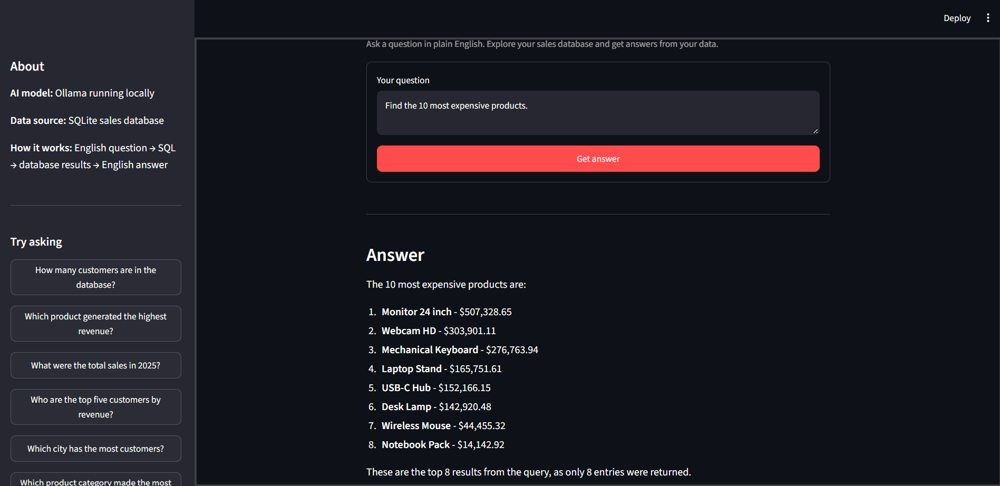
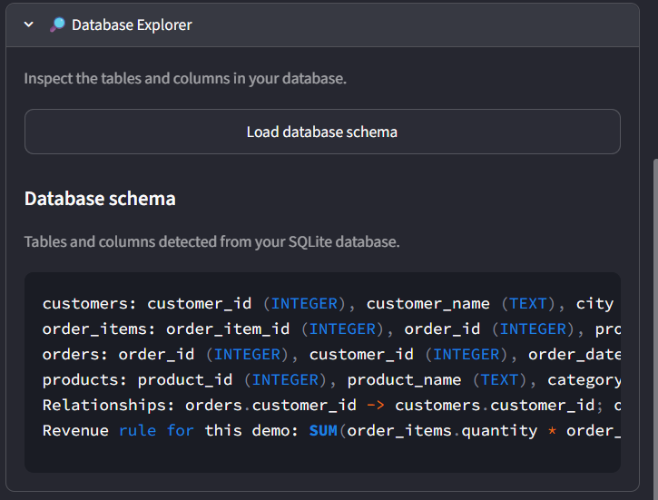
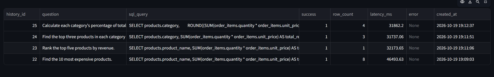
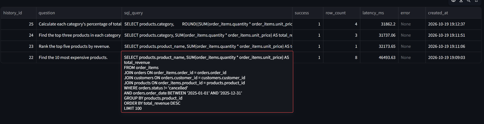
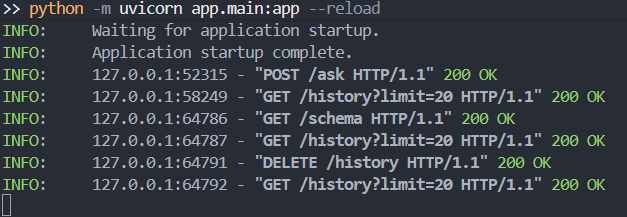

# NL-to-SQL Analytics Agent

Local-first analytics app that turns natural-language questions into validated, read-only SQL against a sample SQLite sales database. Results are summarized in plain English through a Streamlit UI backed by FastAPI and a local Ollama model.

## Features

- Local Ollama model with schema-aware SQL generation.
- SQLGlot validation; read-only SQLite execution with allowed-table, row-count, and query-time limits.
- FastAPI endpoints and Streamlit dashboard; query history and supporting result rows.

## Project layout

```text
app/           FastAPI backend and SQL/database logic
dashboard/     Streamlit UI
data/          Local SQLite database (excluded from Git)
docs/          Architecture notes
evaluation/    Evaluation runner and questions
screenshots/   UI images shown above
tests/         Automated tests
README.md      Setup and usage
requirements.txt
```

See [docs/architecture.md](docs/architecture.md) for component details.

## Setup (Windows PowerShell)

Run from the project root. Requirements: Python 3.12, Git, and Ollama.

```powershell
py -3.12 -m venv .venv
.venv\Scripts\Activate.ps1
python -m pip install -r requirements.txt
ollama pull qwen3:1.7b
```

No paid LLM API key is needed. The app uses `qwen3:1.7b` by default; see [.env.example](.env.example) for configurable environment variables.

The existing sample database is `data\sales.db`. **Do not run `python -m app.init_db` unless you intend to replace the configured database with a fresh sample.**

## Run

Open two terminals in the project root and activate `.venv` in both.

**Terminal 1 — FastAPI**
```powershell
python -m uvicorn app.main:app --reload
```
API docs: <http://127.0.0.1:8000/docs>

**Terminal 2 — Streamlit**
```powershell
python -m streamlit run dashboard\streamlit_app.py
```

## Screenshots

| Dashboard | Database explorer |
|---|---|
| <a href="screenshots/dashboard.png"></a> | <a href="screenshots/database-explorer.png"></a> |

| Query history | Generated SQL |
|---|---|
| <a href="screenshots/query-history.png"></a> | <a href="screenshots/generated-sql-query.png"></a> |

| Example questions |
|---|
| <a href="screenshots/request-questions.png"></a> |

Click any image to open it at full size.

## Test

The database test recreates its configured database. Use a temporary path to protect `data\sales.db`:

```powershell
$testDatabase = Join-Path $env:TEMP ("nl-to-sql-test-" + [guid]::NewGuid().ToString("N") + ".db")
$env:DATABASE_PATH = $testDatabase
try {
    python -m pytest -q
    $testExitCode = $LASTEXITCODE
} finally {
    Remove-Item Env:DATABASE_PATH
    if (Test-Path -LiteralPath $testDatabase) { Remove-Item -LiteralPath $testDatabase }
}
if ($testExitCode -ne 0) { exit $testExitCode }
```

Optional API evaluation (requires FastAPI and Ollama running):
```powershell
python evaluation\evaluate.py
```

## Safety

This demo is not a production security boundary. Do not expose it publicly or connect it to sensitive data without authentication, a security review, and stronger infrastructure controls.
